<div align="center">


<br>


</div>


## ¿Qué es?

**Paceño** es una aplicación web progresiva para explorar bienes y manifestaciones culturales del centro de La Paz: un catálogo documentado, un mapa interactivo y fichas con fuentes verificables.

<div align="center">

| 📚 **13** fichas con fuente | 🧪 **107** pruebas (72 back · 21 unit · 14 E2E) | 📱 **3** tamaños adaptables |
|:--:|:--:|:--:|

</div>


## Qué puedes hacer

| | |
|:--|:--|
| 🔎 **Buscar** | Por nombre, sin distinguir mayúsculas ni tildes. |
| 🗂️ **Filtrar** | Por categoría, con limpieza rápida. |
| 📍 **Explorar el mapa** | Marcadores con vista previa; la lista sirve como alternativa. |
| 📄 **Consultar fichas** | Descripción, ubicación y fuentes documentales. |
| 📏 **Medir distancia** | Opcional y bajo demanda. Se calcula en tu navegador; nunca se envía ni se guarda. |
| 🎓 **Practicar** | Preguntas de opción múltiple por ficha, corregidas en el servidor, con explicación, reintento y puntuación que queda solo en tu navegador. |
| 📣 **Reportar** | Formulario anónimo (tipo + descripción de hasta 500 caracteres) que revisa el equipo editorial. |
| 🛠️ **Administrar** | Panel editorial con roles de Editor y Administrador: fichas, actividades y bandeja de reportes con historial de revisión. |


## Vista previa

<table>
  <tr>
    <td width="50%" align="center"><b>Mapa y lista</b><br>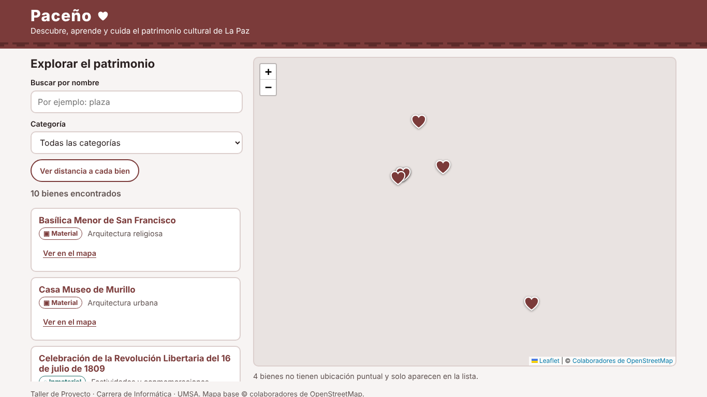</td>
    <td width="50%" align="center"><b>Ficha patrimonial</b><br>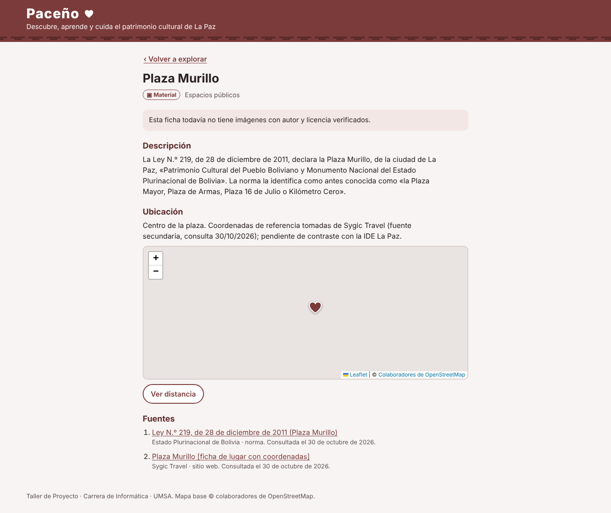</td>
  </tr>
  <tr>
    <td align="center"><b>Móvil · 360 px</b><br>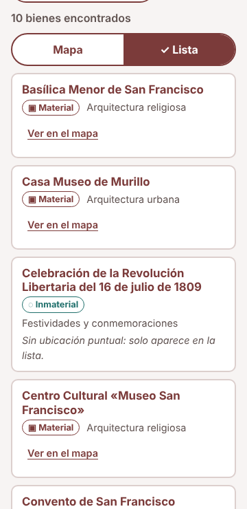</td>
    <td align="center"><b>Panel del Editor</b><br>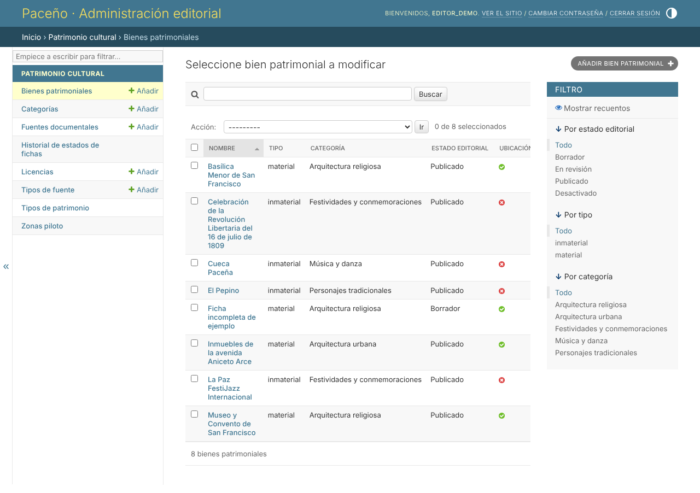</td>
  </tr>
</table>

<details>
<summary><b>Ver más capturas</b></summary>
<br>

<table>
  <tr>
    <td width="33%"><b>Filtro por categoría</b><br>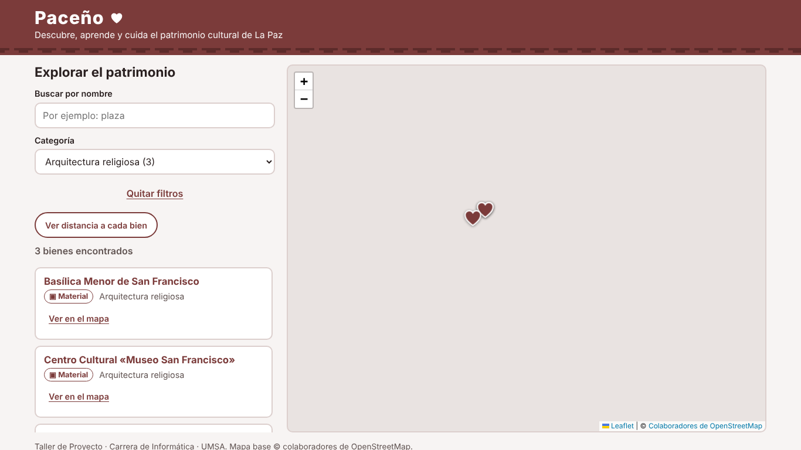</td>
    <td width="33%"><b>Distancia con permiso</b><br>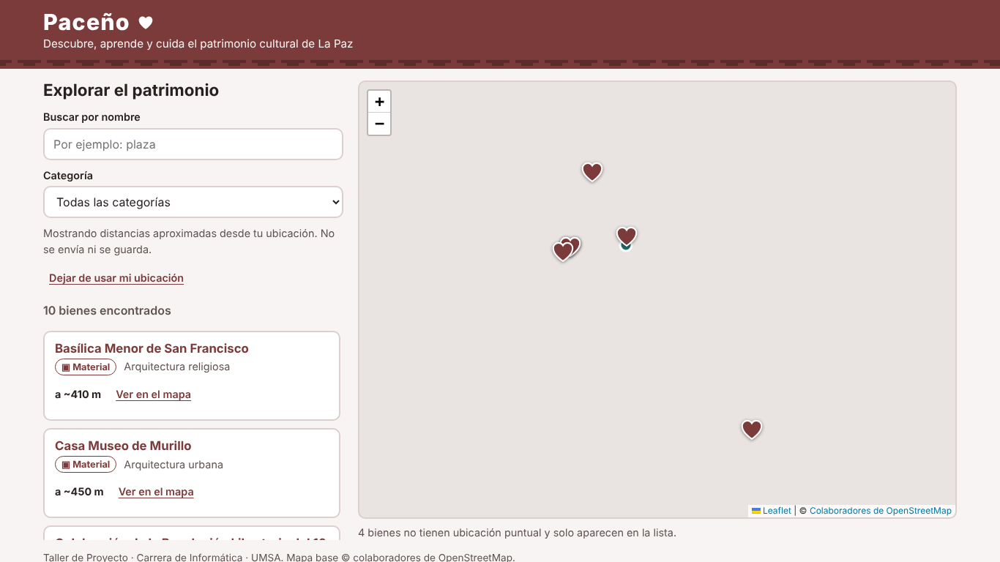</td>
    <td width="33%"><b>Tablet · 768 px</b><br>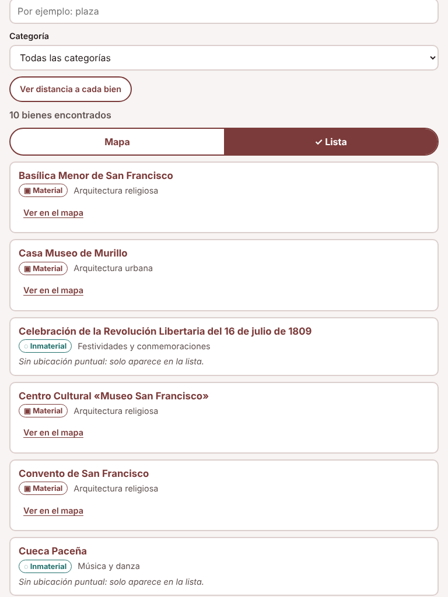</td>
  </tr>
  <tr>
    <td><b>Validación de publicación</b><br>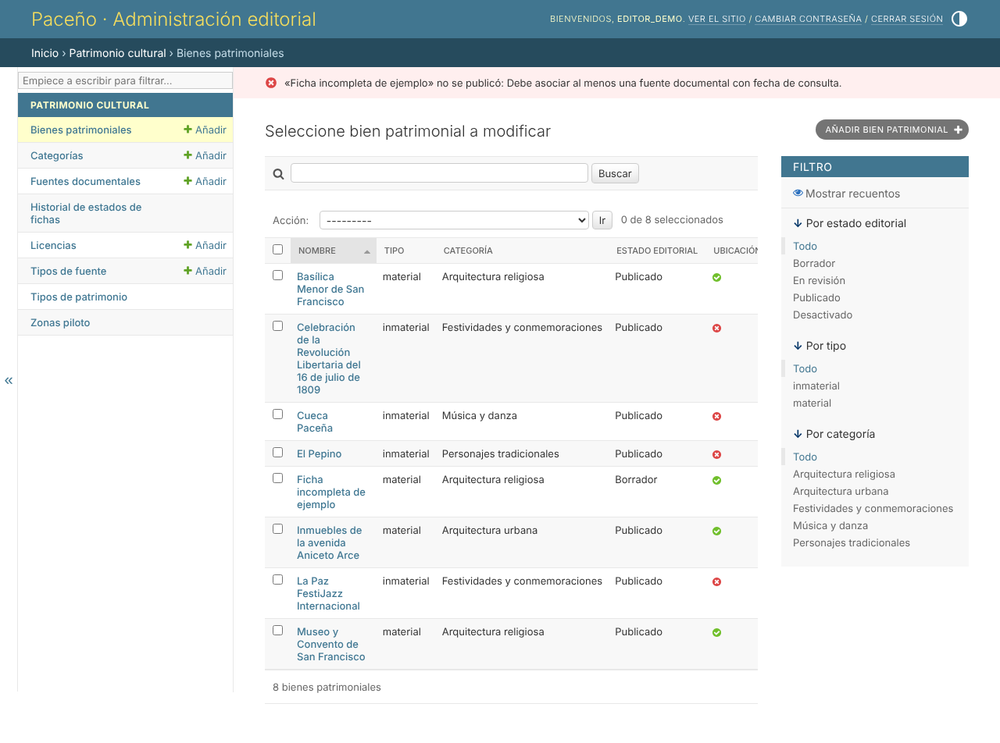</td>
    <td><b>Usuarios del Administrador</b><br>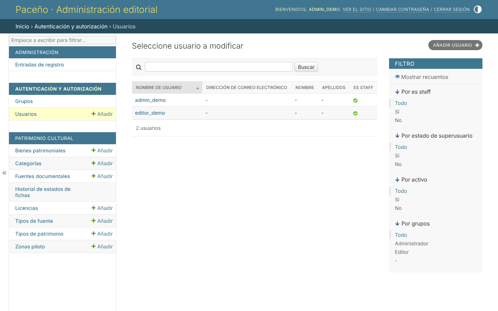</td>
    <td><b>Inicio del Editor</b><br>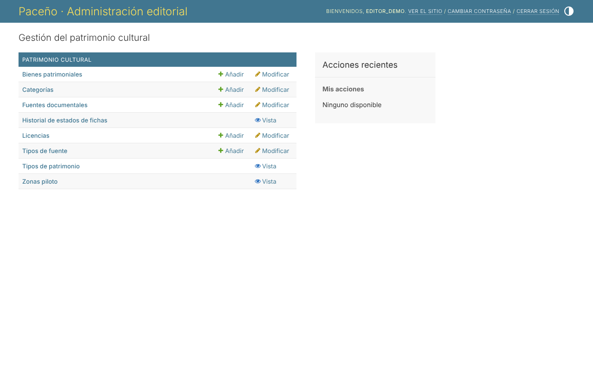</td>
  </tr>
</table>

</details>


## Arquitectura

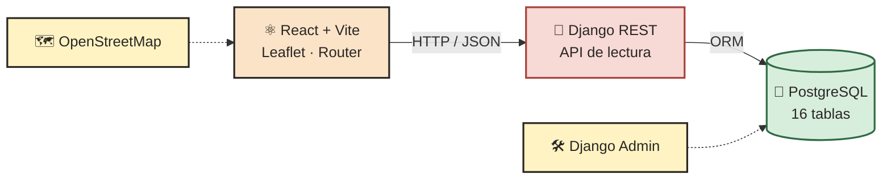

> PostgreSQL sin PostGIS en el MVP · Coordenadas WGS 84 · El mapa requiere conexión a internet.


## Identidad visual

Estilo de **cuaderno cuadriculado** con colores vivos y guiños andinos: franjas de aguayo, chakana y la silueta del Illimani. El rojo aguayo, opaco y no brillante, es el color principal.

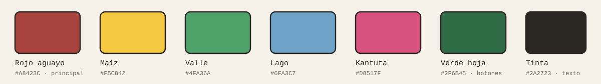

| Uso | Fuente |
|:--|:--|
| Marca | Rubik Mono One |
| Títulos | Cutive Mono |
| Cuerpo y etiquetas | Space Mono |

Tokens listos para usar en [`frontend/src/styles/tokens.css`](frontend/src/styles/tokens.css).


## Inicio rápido (Windows 11)

**Requisitos:** Python 3.12+ · Node.js 20.19+ · PostgreSQL 16 · Git

<table>
  <tr>
    <td width="50%" valign="top">

**Terminal 1 · Backend**

```powershell
cd .\backend
py -3.12 -m venv .venv
.\.venv\Scripts\Activate.ps1
pip install -r requirements.txt
Copy-Item .env.example .env
# Edita .env: DB_PASSWORD y DJANGO_SECRET_KEY
python manage.py migrate
python manage.py cargar_fichas_iniciales --actualizar --retirar-obsoletas
python manage.py cargar_actividades_iniciales
python manage.py crear_cuentas_demo
python manage.py runserver
```

</td>
    <td width="50%" valign="top">

**Terminal 2 · Frontend**

```powershell
cd .\frontend
npm ci
npm run dev
```

Abre **http://localhost:5173**

> Necesitas la base `paceno` y el usuario `paceno` creados en PostgreSQL.

</td>
  </tr>
</table>

**Pruebas:** `python manage.py test` (backend) · `npm test` (frontend) · `npm run e2e` (navegador, con ambos servidores activos).


## Hoja de ruta

| Semana | Alcance | Estado |
|:--|:--|:--:|
| **01** | Django, PostgreSQL, modelo de datos, roles, panel editorial y API | ✅ |
| **02** | PWA React: lista, ficha, mapa, búsqueda, filtros y distancia | ✅ ⚠️ |
| **03** | Actividades de opción múltiple y reportes ciudadanos | ✅ · [guía](docs/semana3.md) |
| **04** | Manifiesto PWA, uso sin conexión, despliegue HTTPS y documentación final | ⏳ |

### Pendientes conocidos

- **Imágenes:** 0 de 13 fichas tienen imágenes cargadas todavía. Ya existe el espacio para cargarlas: [`contenido/imagenes/`](contenido/imagenes/LEEME.md) + `python manage.py cargar_imagenes`.
- **Actividades:** las 10 preguntas de arranque usan solo datos de las fichas y sus leyes; requieren revisión editorial.
- **Coordenadas:** por contrastar con la IDE La Paz; 5 tienen confianza baja (Casa Museo, Calle Jaén, Museo Costumbrista, Museo del Litoral y Teatro Municipal). Los museos de la calle Jaén están a pocos metros y sus marcadores se superponen al alejar el mapa. Detalle en [`verificacion_fichas.md`](docs/verificacion_fichas.md).
- **Patrimonio inmaterial:** las 3 manifestaciones requieren validación con especialistas o personas portadoras.
- **Pruebas E2E:** solo en Chromium sobre Linux; falta Windows 11, Safari, Firefox e iOS. Sin conexión a teselas, el mapa base aparece gris en las capturas.
- **Captura sintética:** `pt09_imagen_sintetica_de_prueba_con_atribucion.png` es una imagen de prueba, no contenido patrimonial real.

Detalle de evidencias: [`docs/evidencias/`](docs/evidencias/) · [`verificacion_fichas.md`](docs/verificacion_fichas.md)

<br>

<div align="center">


**PACEÑO** · Taller de Proyecto · UMSA
Desarrollo de Software e Innovación Tecnológica · La Paz, Bolivia

</div>
